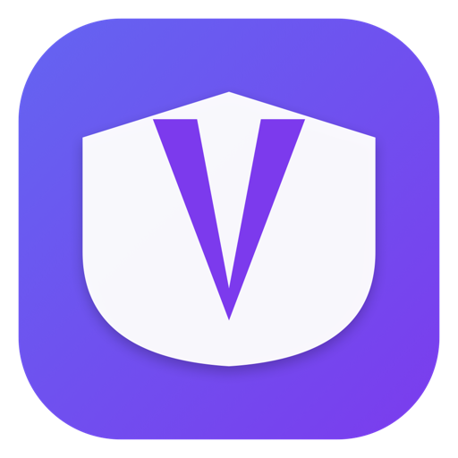

<p align="center">
  
</p>

<h1 align="center">Veil for iOS</h1>

<p align="center">
  A fast, native VPN client for iPhone and iPad.<br>
  Free and open source.
</p>

<p align="center">
  <a href="https://faustyu1.github.io/veil/">Website</a> ·
  <a href="https://github.com/The-Veil-Foundation/veil-macos">macOS</a> ·
  <a href="https://github.com/The-Veil-Foundation/veil-android">Android</a> ·
  <a href="https://github.com/The-Veil-Foundation/veil-ios/issues">Issues</a> ·
  <a href="#support-the-ios-build">Support</a>
</p>

<p align="center">
  <a href="https://www.gnu.org/licenses/agpl-3.0"></a>
  <a href="https://github.com/The-Veil-Foundation/veil-ios/actions/workflows/ios.yml"></a>
  
  
  
  
</p>

---

Veil for iOS is the iPhone and iPad client of [Veil](https://github.com/The-Veil-Foundation/veil-macos).
It is a real VPN, not a proxy: Apple's **NetworkExtension** (`NEPacketTunnelProvider`) tunnels
every app on the device — Telegram, Safari, games, UDP, background traffic. It ships **one** core,
[Xray-core](https://github.com/XTLS/Xray-core): no tun2socks, no sing-box, no second binary.

The model and core layer are shared with the macOS app through the `macos` submodule, so parsers,
config builder, subscriptions, routing and localization behave identically on both.

> **No downloadable build yet.** The tunnel needs an entitlement Apple only grants to paid
> developer accounts — see [Support the iOS build](#support-the-ios-build). Anyone with a paid
> account can [build it from source](#build-from-source).

> **Disclaimer.** Veil is a client for proxy protocols intended for privacy, development, and
> lawful circumvention of censorship. You are responsible for complying with the laws and terms
> of service that apply to you. The bundled core is third-party software under its own licence.

## Features

### Protocols

| Supported | Not supported on iOS |
| --- | --- |
| VLESS (Reality, TLS, XTLS Vision, post-quantum encryption) | Hysteria2 |
| VMess | TUIC |
| Trojan | AnyTLS |
| Shadowsocks | |
| WireGuard (Xray's native outbound) | |

Transports: `tcp`, `ws`, `grpc`, `http`, `xhttp`, `kcp`. The unsupported three need sing-box,
which the iOS build deliberately does not ship — they are imported but greyed out
(`ProxyConfig.xraySupported`).

### One place to add servers

Paste, scan a QR or pick a photo — `AddInputClassifier`
(`macos/Sources/XrayClient/Core/AddInput.swift`) recognises:

- share links, one per line (`vless://`, `vmess://`, `trojan://`, `ss://`, `wireguard://` …),
  with balancer members folded together;
- a wg-quick `[Interface]` profile pasted whole;
- a subscription URL, plain or base64-wrapped;
- a base64 subscription *body* pasted instead of the address.

The sheet shows what it recognised before you commit and stays disabled for anything it cannot place.

### The full desktop feature set

- **Server list** — subscription sections with panel notes, traffic and expiry; grouping by
  source / country / protocol; tag and protocol filters, sort by ping, pins, custom names and tags.
- **Sources** — what each subscription returned, what was skipped and why, the groups the panel
  declared, and a node inspector showing each server as Xray JSON or a share link.
- **Groups** — fastest-node (`urltest`) and manual (`selector`) groups, your own or the panel's.
- **Routing** — presets, custom rules to proxy / direct / block / a server / a group, community
  rule lists and the geo rule database.
- **DNS** — servers, detours, fake IP and DNS rules.
- **Settings** — appearance, list options, startup, subscription refresh and User-Agent, device
  ID, VPN profile and a redacted diagnostics report.
- **Apply now** — routing, DNS, group or tunnel changes reload the core in place without dropping
  the tunnel.
- **Instant switching** — a new server is a core reload over the same utun; iOS never sees the
  VPN drop.

<details>
<summary>What Xray cannot do</summary>

These are left out of the generated config instead of failing it:

- per-app (process) rules, inverted rules, remote rule sets and clash-mode rules;
- DNS-over-TLS servers (DoH, DoH3, QUIC and plain UDP/TCP all work);
- `geosite:` / `geoip:` matchers while the rule database is not downloaded.

A rule whose matchers are all dropped is removed whole, so it never widens into a catch-all.

</details>

## How it works

```
apps ──► iOS routing table ──► utun (created by NetworkExtension)
                                 │  file descriptor
                                 ▼
                       Xray-core `tun` inbound  (gVisor TCP/IP stack)
                                 │  routing rules, sniffing, DNS
                                 ▼
                       VLESS / VMess / Trojan / SS / WireGuard outbound
                                 │
                                 ▼
                              server
```

Xray-core has a native layer-3 `tun` inbound (`proxy/tun`, v26+) with an iOS mode: when the
`xray.tun.fd` flag is set, it adopts that descriptor instead of opening an interface itself.

1. `NEPacketTunnelProvider.startTunnel` applies the network settings, which is when iOS
   materialises the utun interface.
2. It finds the interface's descriptor — there is no API for this, but the utun socket is the
   only one in the process that answers `getsockopt(SYSPROTO_CONTROL, UTUN_OPT_IFNAME)`.
3. `XrayStart(config, fd, …)` publishes the descriptor via `os.Setenv` and boots the core.

Packets never leave the extension process until Xray sends them to the server — no local SOCKS
listener, nothing translating TUN to SOCKS.

`XrayProfileBuilder` (`macos/Sources/XrayClient/Core/XrayProfileBuilder.swift`) turns the whole
app state into one Xray config. Every referenced server becomes an outbound tagged `srv-<id>`; a
fastest-node group becomes a `leastPing` balancer backed by the observatory; a manual group routes
straight to its selected member, since Xray has no runtime selector.

<details>
<summary>App ↔ extension</summary>

They are separate processes, so everything goes through the app group container
`group.dev.local.veil`:

| File | Written by | Read by |
| --- | --- | --- |
| `store.json` | app | app |
| `xray-config.json` | app | extension |
| `session.json` | app | extension |
| `xray.log` | Xray | app (tailed) |
| `last-error.txt` | extension | app |
| `geo/*.dat` | app | Xray |

Live state (traffic counters, balancer health, core version) is pulled with
`NETunnelProviderSession.sendProviderMessage` once a second while connected. The log tail rides
along only while the log screen is open. A `check` message asks the running core to validate a
node config, so the node editor reports the core's own error — which works only while connected.

Traffic counters sum every proxy outbound, so a group's members all count. Literal server IPs are
added to the tunnel's `excludedRoutes`, keeping pings on the real path.

When the routing preset bypasses the LAN (Bypass LAN, China, Russia), the private ranges
(`10/8`, `172.16/12`, `192.168/16`, `169.254/16`, `fc00::/7`, `fe80::/10`) are excluded from the
tunnel too. Domain-based direct rules still go through Xray, because the OS can only exclude by
address. A reload whose routes differ re-applies the network settings on the same utun.

**Switching servers does not reconnect the VPN.** The app writes a new config and sends a
`reload` message; the provider restarts only Xray, keeping the same utun descriptor.

</details>

<details>
<summary>Tunnel shape and reconnects</summary>

- IPv4 `198.18.0.1/24`, default route.
- IPv6 `fd6e:a81b:704f:1211::1/64`, default route — **on by default**, otherwise IPv6-capable
  apps would route around the tunnel and leak. Turn it off in Settings if your server has no IPv6.
- DNS is claimed with `matchDomains = [""]`, so every query enters the tunnel; Xray answers
  port-53 traffic from its own `dns` section, resolving through the proxy.
- MTU 1500 by default (adjustable 1280–1500).
- The Go heap is capped at 48 MB with an aggressive GC — NetworkExtension processes are killed
  outright when they exceed their small memory budget.

The provider watches `NWPathMonitor`. A Wi-Fi ↔ cellular handover invalidates Xray's sockets but
not the utun, so it restarts only the core (debounced 1.5 s) while `reasserting` is set. `wake()`
does the same after the device sleeps.

</details>

## Build from source

```bash
git clone --recurse-submodules https://github.com/The-Veil-Foundation/veil-ios.git && cd veil-ios

Scripts/build-xraycore.sh                              # Xray-core for device + simulator
Scripts/build-app.sh simulator Release
Scripts/build-app.sh device    Release <YOUR_TEAM_ID>
```

> If `macos/` is empty, run `git submodule update --init` first.

`build-xraycore.sh` installs `gomobile` if missing and writes `Frameworks/XrayCore.xcframework`
(gitignored — ~110 MB, reproducible from source). It is a **static** library, linked into the
extension and never embedded. To work in Xcode, open `Veil.xcodeproj` after the first step.

The simulator builds without a team, but has no VPN stack — use it for UI work only.

<details>
<summary>Signing and capabilities</summary>

Running the tunnel on a real device needs a paid Apple Developer account. The App ID for **both**
the app and the extension must have:

- **Network Extensions** → `packet-tunnel-provider`
- **App Groups** → `group.dev.local.veil`

Bundle identifiers are `dev.local.veil` and `dev.local.veil.tunnel`. If you change them, update
`AppGroup.identifier` and `AppGroup.tunnelBundleIdentifier` in `Shared/AppGroup.swift` and both
`.entitlements` files in `Config/`.

</details>

<details>
<summary>Verifying a generated config</summary>

The config the app writes is ordinary Xray JSON, so a desktop core can check it:

```bash
XRAY_TUN_FD=1 ./xray run -test -config xray-config.json
```

Without `XRAY_TUN_FD` the desktop core tries to create the interface itself and fails on
permissions — expected, and unrelated to the config.

</details>

## Project layout

| Path | What it is |
| --- | --- |
| `Veil.xcodeproj` | App + extension targets |
| `App/` | SwiftUI app (server list, settings, routing, QR) |
| `Tunnel/` | `PacketTunnelProvider` — the whole VPN |
| `Shared/` | App-group paths, app ↔ extension IPC, config writer |
| `XrayBridge/` | Go package binding Xray-core for gomobile |
| `Config/` | Entitlements and the extension's `Info.plist` |
| `Scripts/` | Build scripts for the framework and the app |
| `macos/` | Submodule: [veil-macos](https://github.com/The-Veil-Foundation/veil-macos) — its `Sources/XrayClient/Models` and `Core` compile into both targets |

Parsers, config builder, subscription fetcher, routing model, store, ping tester and localization
are the *same files* the desktop app uses, with `#if os(macOS)` for platform differences — one
source of truth, and `swift test` in `macos/` covers both. Shared changes land in veil-macos
first, then the submodule is bumped here.

## Support the iOS build

The tunnel needs the `packet-tunnel-provider` Network Extension entitlement, which Apple only
issues through a **paid Apple Developer Program membership** ($99/year).

**Please don't try to sign the app with an ordinary certificate** — it fails in confusing ways:

- With a free personal team, signing fails outright: the entitlement is rejected without a
  provisioning profile Apple issued.
- Strip the entitlement and the app installs and launches, but the VPN never starts —
  `NETunnelProviderManager` refuses the configuration with no obvious cause.
- AltStore, Sideloadly and other free-account re-signing tools hit the same wall.

So the app builds from source for anyone who already has a paid account, but there is no signed
build to hand out until the membership is funded. If you'd like to help:

- **TON** — `UQDsbwQEaspICRDSW4oSNmL0PXxDlnfkiMuqoUbK7ufiCVXj`
- **RUB** — [CloudTips](https://pay.cloudtips.ru/p/a207bf02)

Nothing in the app is paywalled and none of this changes the licence.

## Other platforms

- **macOS** — [veil-macos](https://github.com/The-Veil-Foundation/veil-macos)
- **Android / Android TV** — [veil-android](https://github.com/The-Veil-Foundation/veil-android)

## Acknowledgements

- [XTLS/Xray-core](https://github.com/XTLS/Xray-core) — proxy engine
- [golang/mobile](https://github.com/golang/mobile) — gomobile bindings

## Star History

<a href="https://star-history.com/#The-Veil-Foundation/veil-ios&Date">
  <picture>
    <source media="(prefers-color-scheme: dark)" srcset="https://api.star-history.com/svg?repos=The-Veil-Foundation/veil-ios&type=Date&theme=dark">
    <source media="(prefers-color-scheme: light)" srcset="https://api.star-history.com/svg?repos=The-Veil-Foundation/veil-ios&type=Date">
    
  </picture>
</a>

## License

Veil for iOS is free software, licensed under the **GNU Affero General Public License v3.0** —
see [LICENSE](LICENSE), same as the macOS app. [Xray-core](https://github.com/XTLS/Xray-core)
remains under its own licence (MPL-2.0).
